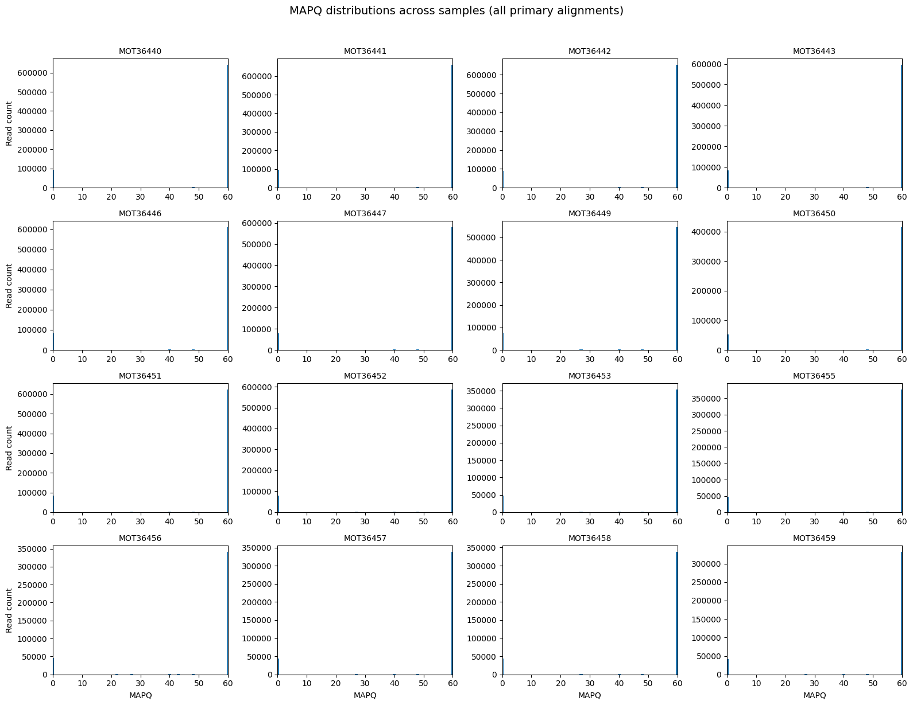
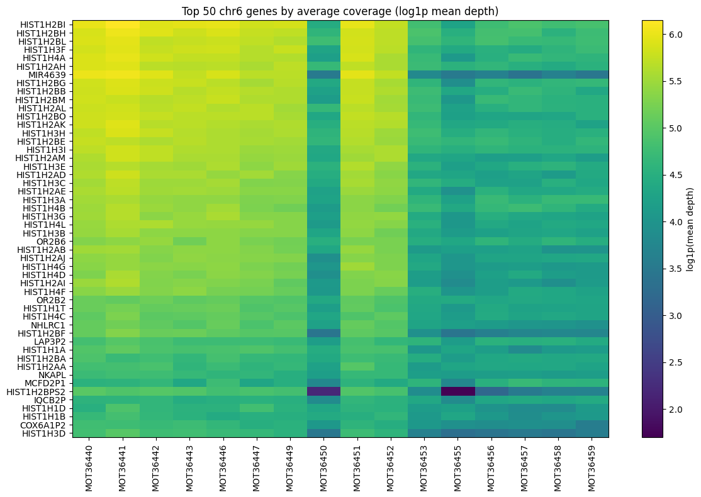
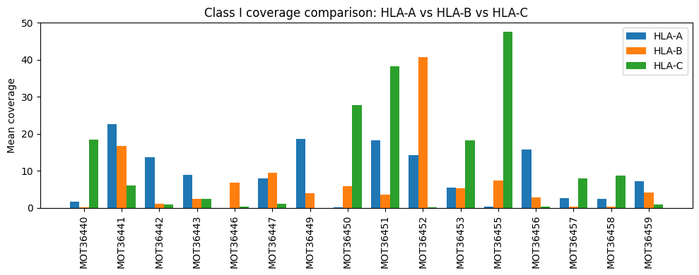

# Chromosome 6 Coverage and MHC Gene Analysis

Exploring alignment quality and gene-level coverage across 16 samples, with a focus on the major histocompatibility complex (MHC).

**Diana Naseh · Undergraduate Bioinformatics Project**

## Overview

How does sequencing coverage vary across samples, and what do those differences look like in immune-related genes?

I developed this project to investigate these questions using chromosome 6 BAM files and GENCODE annotations. The workflow connects genomic file processing, alignment-quality assessment, and comparative visualization, moving from a chromosome-wide view to selected MHC genes.

The analysis highlights an important distinction: consistently high mapping-quality summaries can coexist with uneven coverage at individual loci.

**[Explore the notebook →](MHC_Genomics_Analysis.ipynb)**

## Dataset

The project uses my assigned subset of **16 samples** from an 80-sample course dataset.

| Input | Role |
| --- | --- |
| Chromosome 6 BAM files | Aligned sequencing reads for each sample |
| GENCODE v19 GTF | Gene annotations on GRCh37 |
| Chromosome 6 reference FASTA | Reference-sequence extraction for annotated intervals |

The MHC panel includes HLA-A, HLA-B, and HLA-C; HLA-DRB1 and HLA-DQB1; selected class III-region genes; and MICA and MICB.

## Analysis workflow

1. **Inspect the inputs:** examine annotation records, BAM headers, example alignments, and read-length and pairing summaries.
2. **Annotate gene intervals:** identify genes with eligible overlapping alignments and export per-sample annotation tables.
3. **Assess alignment quality:** summarize mapping statistics and compare MAPQ distributions across samples.
4. **Compare chromosome-wide coverage:** rank genes by recorded mean depth and visualize cross-sample patterns.
5. **Examine MHC genes:** compare gene-span depth and zero-depth fractions, including a focused HLA-A/HLA-B/HLA-C comparison.

## Selected findings

### Consistent mapping-quality summaries

The QC summary reports a median MAPQ of **60 for all 16 samples** within the counted alignments. No samples were flagged by the workflow's heuristic QC thresholds.

*MAPQ distributions for primary mapped, nonduplicate records with MAPQ 0–60. Each panel uses its own read-count scale; the summaries describe the supplied BAM subsets.*

### Shared high-coverage genes, with variation across samples

HIST1-family genes feature prominently among the 50 gene symbols with the highest average recorded depth. The heatmap also shows differences in coverage intensity between samples.

*Gene-span depth estimates on a log1p scale. Values are not normalized for library size and are interpreted as descriptive coverage patterns.*

### Uneven coverage across class I HLA genes

The relative coverage of HLA-A, HLA-B, and HLA-C varies substantially across samples. Examining these loci individually reveals differences that are not apparent from the overall mapping-quality summaries.

*Mean depth across the annotated genomic span of each gene, calculated using the notebook's MHC-specific counting procedure. Additional MHC depth and gap heatmaps are available in the notebook.*

## Analysis scope

This is an exploratory coverage analysis. Gene spans include introns, and the chromosome-wide and MHC sections use different counting and filtering procedures. The notebook documents these choices, including the handling of repeated gene symbols, alongside the relevant results.

The project focuses on alignment quality and coverage rather than sample-specific HLA genotyping. Exported gene sequences come from the reference genome.

## Tools

**Python · pysam · SAMtools · pandas · NumPy · Matplotlib · Biopython**

## Repository contents

| File | Description |
| --- | --- |
| [`MHC_Genomics_Analysis.ipynb`](MHC_Genomics_Analysis.ipynb) | Analysis code, explanations, saved tables, and figures |
| [`figures/`](figures/) | Selected notebook figures used in this README |

## Data availability

The original course-provided BAM files are no longer available to me and are not included in this repository. The notebook retains its saved outputs for viewing; rerunning the analysis requires the original input files.
